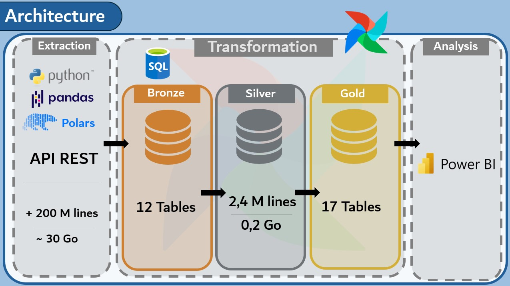
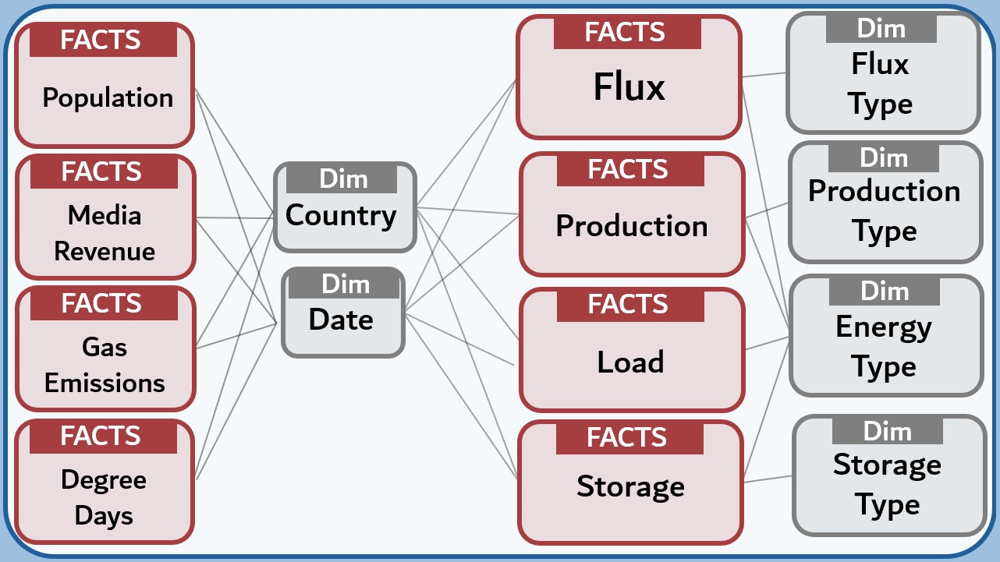
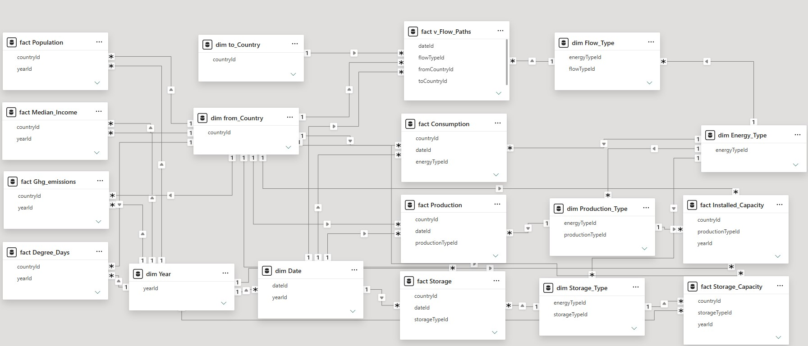

# European Energy Data Pipeline

A data engineering pipeline that collects, cleans and models public European energy data (electricity and gas), from API extraction all the way to Power BI dashboards.

Built as the final project of the **Data Engineer** program at Bruxelles Formation.


##  Reproducibility

This project was developed and tested on a specific local setup (Windows, SQL Server Express, Airflow in Docker). It **cannot be run** on another machine.
The code is published to showcase the architecture and the technical choices.


## Goal

Bring together data that is usually scattered across several sources into a single model.

## Data sources

| Source | Data | Frequency |
|---|---|---|
| [ENTSO-E Transparency Platform](https://transparency.entsoe.eu/) | Electricity generation per type, load, installed capacity, cross-border physical flows | Hourly / 15 min |
| [ENTSOG Transparency Platform](https://transparency.entsog.eu/) | Physical gas flows at interconnection points, point and operator reference data | Hourly / daily |
| [AGSI+ (GIE)](https://agsi.gie.eu/) | Gas storage per country | Daily |
| [Eurostat](https://ec.europa.eu/eurostat) | Population, median income, CO₂ emissions, heating and cooling degree days | Yearly |
| [Country reference](https://restcountries.com) | Country codes, names, coordinates (latitude / longitude) | Static |

## Architecture

As shown on the image below, the Medallion Architecture has been used for this project. In a nutshell, data are extracted from the sources' REST APIs, ingested into a bronze database, transformed and cleaned in a silver database, and loaded as a dimensional model in a gold database, ready for analysis.



At the start, more than 200 million rows were extracted, for a total size of 30 Go. After transformation, only 2.4 millions rows remained, because of the change in granularity. The lowest frequency of gas and electricity data retrieved was daily, so all other datas (15min and hourly) was aggregated to daily.

### Stack

| Role | Tool |
|---|---|
| Orchestration | Apache Airflow 3 (Docker Compose, LocalExecutor) |
| Extraction | Python, requests, pandas, Polars |
| Storage and transformation | SQL Server Express 2025 (T-SQL) |
| Visualisation | Power BI |

## Project structure

```
Project/
|──
|── config/                      # Config files for Airflow
|── docker-compose.yaml          # Configuration and organization of Docker 
|── dags/
│   ├── historical_dag.py        # Full historical load
│   ├── daily_dag.py             # Daily update
│   └── pipeline/                # All the scripts and functions that are called in the dags
│       ├── historical/
│       └── daily/
|── images/                      # Images
|── README.md
|── docker-compose.yaml          # Configuration and organization of Docker 
```

## Airflow pipelines

Two pipelines were built. The first one is the **initial load**, which extracts all the historical datas for all the sources. The second one is the **incremental load** that runs every morning to download all the new and updated data. 

### Historical DAG


```
extract  >>  compact  >>  setupDB  >>  ingest  >>  transform >> load
```

- **extract**: API downloads, one file per month and per source. (+5 000 files)
- **compact**: compacts all CSV files of each source into a single file to facilitate ingestion in a SQL database.
- **setupDB**: creates the databases, the bronze and gold tables.
- **ingest**: `BULK INSERT` into bronze.
- **transform**: transforms and cleans the data (ex: normalized time period in daily).
- **load** : loads all the data in the Data Warehouse.

### Daily DAG

```
extract  >>  compact  >> ingest >> merge >> load >> update_watermark
```
- **extract**: API downloads, one file per month and per source. (+1 000 files)
- **compact**: compacts all CSV files of each source into a single file to facilitate ingestion in a SQL database.
- **ingest**: `BULK INSERT` into a new database called newBronze.
- **merge** : upsert the newBronze in the silver. Check if the row exists, if it exists : update the row, if not : add it.
- **load** : deletes the gold layer, recreates if and loads all the data in the Data Warehouse.
- **update_watermark** : keeps a mark when the update was run and what day was downloaded, so the next run knows where to start.


## Gold model

Here is an extremely schematic view of the Data Warehouse to highlight the principle tables, the full model is shown at the end of the README. 
The gold layer is a **galaxy schema**. All fact tables are linked through the Date and the Country



## Visualisations


**Mathias Petini** – [GitHub](https://github.com/mpetini1307)

## Appendix 
Full DWH from the model view of PowerBI

